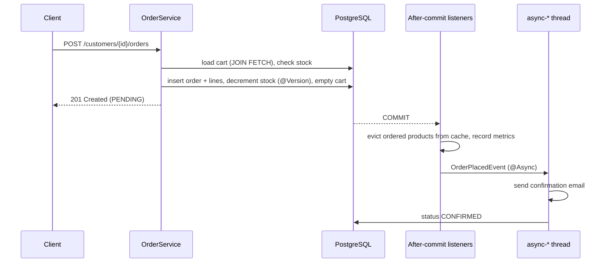

# E-commerce Backend — Spring Boot 4

[](https://github.com/kardiguemagassa/ecommerce/actions/workflows/ci.yml)
[](https://github.com/kardiguemagassa/ecommerce/actions/workflows/release.yml)

A simplified e-commerce REST API: product catalog with search and caching, shopping cart, and orders
confirmed asynchronously. Built as a production-minded showcase: query optimization, transactional
consistency, caching, observability and an automated test suite.

## Features

- **Products** — CRUD, paginated search filtered by category and name, bean validation
- **Categories** — CRUD with case-insensitive unique names; deletion blocked while in use
- **Cart** — one cart per customer: add (merges quantities), remove, clear, live total
- **Orders** — placed atomically from the cart (price snapshot, stock decrement, cart emptied),
  then confirmed **asynchronously** after commit (email + status `PENDING` → `CONFIRMED`)
- **Best sellers** — `GET /api/products/top-selling`, cached
- **Errors** — uniform [RFC 9457](https://www.rfc-editor.org/rfc/rfc9457) `application/problem+json`
- **Observability** — OpenTelemetry traces (HTTP, SQL, async confirmation), metrics and logs, Grafana dashboard
- **API documentation** — OpenAPI 3 / Swagger UI, switchable off for production

## Tech stack

| Area | Choice |
|---|---|
| Language / runtime | Java 21 |
| Framework | Spring Boot 4.1 (Spring 7, Hibernate 7, Jackson 3) |
| Database | PostgreSQL 18, schema versioned with Flyway |
| Identity | Keycloak 26 (OpenID Connect), realm `ecommerce` |
| Cache | Caffeine (Spring Cache abstraction) |
| Observability | Micrometer, OpenTelemetry (OTLP), Grafana LGTM: Tempo, Prometheus, Loki |
| API docs | springdoc-openapi 3 |
| Tests | JUnit 5, Mockito, AssertJ, Awaitility, Testcontainers (PostgreSQL), JaCoCo |
| Build | Maven (Surefire for unit tests, Failsafe for integration tests) |
| Packaging | Docker multi-stage image (layered, non-root), Docker Compose |

## Getting started

### Prerequisites

- Docker: database, Keycloak, observability backend, tests (Testcontainers), and optionally the API itself
- Java 21, to build and run the application outside a container

### Configuration

Copy the template and fill in your local values. `.env` is git-ignored and loaded automatically
by Spring (`spring.config.import`) and by Docker Compose.

```bash
cp .env.example .env
```

| Variable | Purpose | Default |
|---|---|---|
| `POSTGRES_HOST`, `POSTGRES_PORT`, `POSTGRES_DB` | Database location | — |
| `POSTGRES_USERNAME`, `POSTGRES_PASSWORD` | Database credentials | — |
| `MANAGEMENT_PORT` | Actuator port | `8081` |
| `API_PORT` | API port published by Compose | `8080` |
| `KEYCLOAK_PORT`, `KEYCLOAK_ADMIN_USERNAME`, `KEYCLOAK_ADMIN_PASSWORD`, `KEYCLOAK_DB_PASSWORD` | Keycloak and its admin console | `8180` |
| `BFF_CLIENT_SECRET` | Secret of the confidential client `ecommerce-bff` | — |
| `DEMO_USER_PASSWORD` | Password of the demo users (12 characters minimum) | — |
| `SHOP_ADMIN_EMAIL` | E-mail (and username) of the shop administrator, kept out of Git | — |
| `TRACING_SAMPLING_PROBABILITY` | Share of requests traced | `0.1` (`1.0` in `.env.example` and Compose) |
| `API_DOCS_ENABLED` | Expose OpenAPI + Swagger UI | `true` (set `false` in production) |

### Run

PostgreSQL, Keycloak and the observability backend always run in Docker (`compose.yml`; database data kept in the
`postgres-data` volume). The API
runs either from the IDE / Maven, or in a container too:

```bash
# Database in Docker, API on the host (hot reload with DevTools)
docker compose up -d --wait
./mvnw spring-boot:run

# Everything in Docker
docker compose --profile app up -d --build --wait

# Stop (data kept); add -v to delete the database volume
docker compose --profile app down
```

Every port is published on `127.0.0.1` only. The API container runs as a non-root user, with a 512 MB
memory limit from which the JVM sizes its heap.

| URL | Content |
|---|---|
| http://localhost:8080/api/... | REST API |
| http://localhost:8080/swagger-ui.html | Swagger UI |
| http://localhost:8080/v3/api-docs | OpenAPI document (JSON) |
| http://localhost:8081/actuator/health | Health, liveness and readiness probes |
| http://localhost:8081/actuator/metrics | Metrics (also pushed over OTLP) |
| http://localhost:3000 | Grafana: dashboard, traces, logs (admin / admin) |
| http://localhost:8180 | Keycloak: admin console (`KEYCLOAK_ADMIN_*`), realm `ecommerce` |

Ready-to-run requests for the IntelliJ HTTP client are in [`http/`](http/) (environment `dev`). Each file starts by
signing in; put the demo password (and your `SHOP_ADMIN_EMAIL` as `adminEmail`) in
`http/http-client.private.env.json`, git-ignored, and run `./scripts/dev-token.sh alice@example.com` once to create the
development client.

### Identity provider (Keycloak)

The realm `ecommerce` is imported from [`keycloak/realm-ecommerce.json`](keycloak/realm-ecommerce.json) on the first
start of Keycloak (an existing realm is never overwritten: `docker compose down` then remove the `keycloak-db-data`
volume to re-import it). Secrets and passwords are placeholders resolved from `.env` at import: none is in Git.

| Element | Content |
|---|---|
| Realm roles | `CUSTOMER` (given to every new user: own cart and orders), `ADMIN` (catalog, customer support) |
| `ecommerce-bff` | Confidential client of the API: browser login (authorization code + PKCE), tokens kept server-side |
| `ecommerce-swagger` | Public client of Swagger UI (authorization code + PKCE) |
| Demo users | `alice@example.com` (`CUSTOMER`) and the shop administrator `SHOP_ADMIN_EMAIL` (`CUSTOMER`, `ADMIN`; `admin@example.com` in `.env.example`), password `DEMO_USER_PASSWORD` |
| Policies | French login pages, self-registration with the e-mail as username, passwords of 12 characters minimum, brute-force protection, access tokens valid 5 minutes |

Access tokens carry the audience `ecommerce-api` and the realm roles in a `roles` claim.

### Database migrations

The schema is owned by [Flyway](https://documentation.red-gate.com/flyway) scripts in
[`src/main/resources/db/migration`](src/main/resources/db/migration), applied on startup.
Hibernate only validates it (`ddl-auto: validate`): the application refuses to start if the
entities and the schema disagree.

| Version | Change |
|---|---|
| `V1` | Initial schema (tables, sequences, constraints, indexes of v1.0.0) |
| `V2` | Unique index on `lower(name)` for categories |

A database created by v1.0.0 (schema generated by Hibernate, no Flyway history) must be
**baselined once** at V1, so that Flyway only applies the later scripts:

```bash
SPRING_FLYWAY_BASELINE_ON_MIGRATE=true ./mvnw spring-boot:run
```

Baselining is not enabled permanently: on an unexpected non-empty database, failing is safer than
silently skipping V1.

## API overview

| Method | Path | Description |
|---|---|---|
| `GET` | `/api/categories` | List categories |
| `GET` `POST` `PUT` `DELETE` | `/api/categories[/{id}]` | Category CRUD |
| `GET` | `/api/products?categoryId=&name=&page=&size=&sort=` | Search products (sort: id, name, price, stock) |
| `GET` | `/api/products/{id}` | Product details (cached) |
| `GET` | `/api/products/top-selling?limit=10` | Best sellers (1–50, cached) |
| `POST` `PUT` `DELETE` | `/api/products[/{id}]` | Product management |
| `GET` | `/api/me` | My customer profile (created on the first call) |
| `GET` `DELETE` | `/api/me/cart` | Get / empty my cart |
| `POST` | `/api/me/cart/items` | Add a product |
| `DELETE` | `/api/me/cart/items/{productId}` | Remove a product |
| `POST` | `/api/me/orders` | Place an order from my cart |
| `GET` | `/api/me/orders` | My order history (paginated, newest first) |
| `GET` | `/api/me/orders/{orderId}` | One of my orders with its lines |
| `GET` | `/api/admin/customers/{id}[/orders[/{orderId}]]` | Customer support: a customer, their orders |

### Security

Two ways in, one set of rules:

| Client | Authentication | Where the tokens are |
|---|---|---|
| Browser (React front-end, v2.0.0) | **Backend for Frontend**: `/oauth2/authorization/keycloak` signs in with Keycloak (authorization code + PKCE, confidential client `ecommerce-bff`), then an `HttpOnly`, `SameSite=Lax` session cookie | On the server only: JavaScript never sees a token |
| Swagger UI, curl, other services | OAuth2 **resource server**: `Authorization: Bearer <access token>`, checked for signature (realm keys), issuer, audience `ecommerce-api` and expiry | With the client |

Browser sessions:

- `GET /api/me/session` (public) tells the front-end whether it is signed in, with the name, e-mail and roles, never
  a token; it also sets the `XSRF-TOKEN` cookie.
- Writes made with the session cookie need that token back in the `X-XSRF-TOKEN` header (CSRF); bearer-token calls
  are not concerned (a browser never sends a bearer token on its own).
- `POST /logout` closes the session and answers `{"logoutUrl": ...}`: the Keycloak end-session URL the front-end
  navigates to, so that single sign-on does not log the user back in.
- After login and logout the browser lands on `BFF_FRONT_URL` (`/api/me/session` until the front-end exists).

Swagger UI: **Authorize** signs in with Keycloak (public client `ecommerce-swagger`, PKCE), then sends the token
with every call.

| Routes | Access |
|---|---|
| `GET` on products and categories | Public |
| Writes on products and categories, `/api/admin/**` | Realm role `ADMIN` |
| `/api/me/**` | Realm role `CUSTOMER` (every user has it) |
| Anything else | Refused (a new endpoint is closed until a rule opens it) |

There is no sign-up endpoint and no customer id in the URLs: the customer is always the one of the token. Their
record is created on their first call from the token claims (`sub`, `email`, `name`), and their e-mail and name follow
Keycloak afterwards. A customer created before authentication is attached to the Keycloak user with the same e-mail,
only if Keycloak verified that e-mail.

A token of a demo user for curl or scripts (development only, password grant on a local client created on first use):

```bash
curl -H "Authorization: Bearer $(./scripts/dev-token.sh alice@example.com)" http://localhost:8080/api/me
```

The full contract, with request/response schemas and error codes, is in Swagger UI.

### Error format

All errors share the RFC 9457 structure; validation errors add a field-by-field `errors` map:

```json
{
  "type": "about:blank",
  "title": "Bad Request",
  "status": 400,
  "detail": "Invalid request content.",
  "instance": "/api/products",
  "errors": { "price": "must be greater than 0" }
}
```

| Status | When |
|---|---|
| `400` | Validation error, malformed body, unsupported sort property, page size above 100 |
| `401` | Missing, invalid or expired token (`code`: `UNAUTHENTICATED`, `WWW-Authenticate: Bearer`) |
| `403` | Valid token without the required role (`code`: `ACCESS_DENIED`) |
| `404` | Unknown resource, or an order belonging to another customer |
| `409` | Duplicate, resource in use, insufficient stock, empty cart, concurrent modification |

## Architecture

```
src/main/java/com/kmgtechnologies/ecommerce
├── controller     REST layer: validation, HTTP mapping, sort allow-list
├── service        Use cases and transaction boundaries
├── repository     Spring Data JPA, DTO projections, fetch plans
├── entity         Aggregates: Cart → CartItem, Order → OrderItem
├── dto            Request/response records (entities never leave the service layer)
├── event          OrderPlacedEvent
├── notification   Asynchronous order confirmation
├── cache          Cache eviction after commit
├── metrics        Business metrics
├── exception      Domain exceptions and RFC 9457 handler
└── config         Cache, async executor, clock, OpenAPI
```

### Order placement flow



Every side effect runs **after commit**: a rolled-back order (e.g. insufficient stock) sends no email,
evicts nothing and is not counted.

## Technical choices

| Concern | Decision | Why |
|---|---|---|
| N+1 queries | DTO projections (`select new ...`) for lists, `JOIN FETCH` for the cart, `@EntityGraph` for order details; `open-in-view: false` | One query per use case; lazy loading cannot leak into the web layer |
| Schema | Flyway migrations, Hibernate `validate` | Reviewed, versioned DDL; drift between entities and schema fails at startup |
| Identifiers | `SEQUENCE` with `allocationSize = 50` | Enables JDBC batching; avoids one round-trip per insert, unlike `IDENTITY` |
| Concurrency | Optimistic locking (`@Version`) on products and orders → `409` | Two orders cannot oversell the last unit; no long-held locks |
| Order history | Product name and unit price snapshotted in `OrderItem` | Past orders stay correct after a price change |
| Pagination | Max page size 100, sort properties allow-listed | Prevents unbounded queries and sorting on non-indexed or internal fields |
| Caching | Caffeine: product details (10 min, 1000 entries), best sellers (5 min); transaction-aware cache manager; eviction on update/delete and after each order | Hot reads skip the database; a rolled-back transaction never corrupts the cache |
| Async work | `@TransactionalEventListener(AFTER_COMMIT)` + `@Async` on a bounded pool | The HTTP response does not wait for the email |
| Time | Injected `Clock` | Deterministic tests on timestamps |
| Secrets | Environment variables / git-ignored `.env`, no credential in the repository | Twelve-factor configuration |
| Container image | Multi-stage build, layered jar, non-root user, G1 with heap sized from the memory limit | A code change ships one small layer; least privilege; predictable memory |

## Observability

Traces, metrics and logs are exported over **OTLP** (OpenTelemetry) to `grafana/otel-lgtm` in development: one
container with the OpenTelemetry collector, Tempo (traces), Prometheus (metrics), Loki (logs) and Grafana, started by
`docker compose up -d`. Changing backend (Grafana Cloud, Datadog, Elastic...) means changing the OTLP endpoints, not
the code.

| Signal | What you get |
|---|---|
| **Traces** | One trace per request: HTTP, every SQL query, and for an order the **asynchronous confirmation** in the same trace (context propagated to the `@Async` thread). Sampling 100 % in development, 10 % by default |
| **Logs** | Console unchanged, and every log line sent to Loki with its trace and span ids |
| **Metrics** | Pushed every 10 s in Compose (1 min by default), shown by the *E-commerce — Vue d'ensemble* dashboard |
| **Errors** | Every RFC 9457 response carries a `traceId`: a reported error leads straight to its trace |

Health probes and SQL run outside of any request (Flyway, connection pool) create no trace. SQL spans never contain
parameter values.

| Metric | Source |
|---|---|
| `ecommerce_orders_placed_total` | Orders committed (counted after commit) |
| `ecommerce_orders_amount` | Order amounts: count, sum, max (revenue, average basket) |
| `ecommerce_orders_confirmation_milliseconds{outcome}` | Duration of the async confirmation, success/failure |
| `http_server_requests_milliseconds` | Per-endpoint traffic, status and latency histogram (p95) |
| `cache_gets_total{result}` | Cache hits and misses |
| `hikaricp_*`, `executor_*`, `jvm_*` | Connection pool, async pool, JVM |

Actuator runs on a **separate management port** (`8081`), so the public API port never exposes `/actuator`. Only
`health`, `info` and `metrics` are exposed; health details are hidden.

### Following an order in Grafana

http://localhost:3000 (admin / admin):

- **Dashboards → E-commerce → Vue d'ensemble**: orders per minute, revenue, average basket, cache hit ratio, p95
  latency per endpoint, confirmation duration (provisioned from `observability/grafana`, read-only)
- **Explore → Tempo**, query `{ resource.service.name = "ecommerce" && span.http.route = "/api/me/orders" }`:
  the order trace, with its SQL queries and the `order confirmation` span; **Logs for this span** opens the matching
  lines in Loki
- **Explore → Loki**: `{service_name="ecommerce"} | trace_id="<traceId>"` for the logs of one request

`./scripts/smoke.sh` does all of this automatically against the running stack (also run by CI): it places an order,
then checks the `traceId` of an error, the order trace in Tempo and its confirmation logs in Loki.

## Tests

```bash
./mvnw test      # unit and slice tests (Surefire)
./mvnw verify    # + integration tests (Failsafe) + JaCoCo report
```

Tests run against a **real PostgreSQL 18** started by Testcontainers (Docker must be running): the
same Flyway migrations as in production, then Hibernate schema validation. One container per test JVM,
shared by all Spring contexts.

| Level | Tools | Scope |
|---|---|---|
| Entities | JUnit | Aggregate invariants (cart merging, stock, order status) |
| Services | Mockito | Business rules, events published or not |
| Repositories | `@DataJpaTest` on PostgreSQL | Migrations, queries, projections, constraints |
| Controllers | `@WebMvcTest` | Validation, status codes, RFC 9457 payloads |
| Observability | JUnit, OpenTelemetry SDK (in-memory) | Noise filter, logs exported with their trace id, `traceId` in errors |
| Security | `@WebMvcTest` with `@WithMockUser` / `oidcLogin()`, JUnit | 401 / 403 per route, CSRF on session writes, session endpoint, logout URL, roles of the ID token, first-call provisioning |
| Integration (`*IT`) | `@SpringBootTest` | Async confirmation, caching, Actuator exposure, OpenAPI contract and its production switch |

208 tests (188 unit/slice, 20 integration). Coverage report: `target/site/jacoco/index.html`.

## Known limitations and next steps

| Limitation | Next step |
|---|---|
| In-memory sessions: one API instance, sessions lost on restart | Spring Session with Redis or JDBC when running several instances |
| Confirmation is lost if the app stops between commit and email (order stays `PENDING`) | Transactional outbox + retry, or a message broker |
| Caffeine is local to one instance | Redis when running several instances |
| `name LIKE '%x%'` cannot use a B-tree index | PostgreSQL `pg_trgm` GIN index or full-text search |
| Async pool grows beyond 2 threads only when its queue (100) is full | Size `core-size` from `executor_queued_tasks` and confirmation latency |

## CI/CD

| Workflow | When | What |
|---|---|---|
| [CI](.github/workflows/ci.yml) | Every pull request to `dev`/`main`, every push to `dev` | `build`: `./mvnw verify` (tests on PostgreSQL 18, coverage summary). `smoke`: the Compose stack built and started, then `scripts/smoke.sh` |
| [Release](.github/workflows/release.yml) | Push to `main`, tag `vX.Y.Z` | Tests again, image scanned by Trivy (no fixable CRITICAL vulnerability), then pushed to Docker Hub for amd64 and arm64 with SBOM and provenance |
| [Dependabot](.github/dependabot.yml) | Weekly | Update pull requests to `dev`: GitHub Actions, Maven, Dockerfile and Compose images |

Image: [`kardigue/ecommerce-api`](https://hub.docker.com/r/kardigue/ecommerce-api), tags `X.Y.Z`, `X.Y`, `latest` (releases),
`main` and `sha-<commit>`. Actions are pinned by commit SHA; workflows only read the repository.

To run a published release instead of building locally:

```bash
IMAGE_NAMESPACE=kardigue IMAGE_TAG=1.1.0 docker compose --profile app up -d --no-build --wait
```

## Workflow

- Feature branches merged into `dev` through pull requests; `main` and `dev` are protected, CI `build` and `smoke` required
- [Conventional Commits](https://www.conventionalcommits.org/) (`feat`, `fix`, `test`, `build`, `docs`, `chore`)
