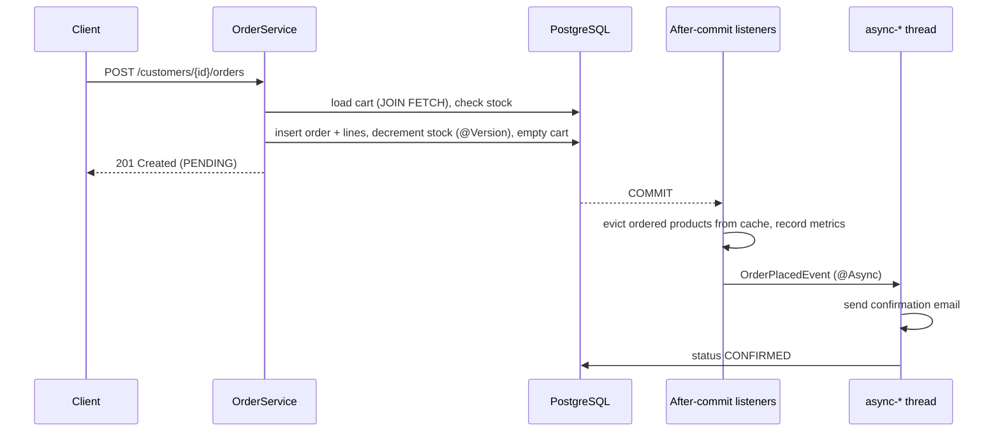

# E-commerce Backend — Spring Boot 4

A simplified e-commerce REST API: product catalog with search and caching, shopping cart, and orders
confirmed asynchronously. Built as a production-minded showcase: query optimization, transactional
consistency, caching, observability and an automated test suite.

## Features

- **Products** — CRUD, paginated search filtered by category and name, bean validation
- **Categories** — CRUD with case-insensitive unique names; deletion blocked while in use
- **Cart** — one cart per customer: add (merges quantities), remove, clear, live total
- **Orders** — placed atomically from the cart (price snapshot, stock decrement, cart emptied),
  then confirmed **asynchronously** after commit (email + status `PENDING` → `CONFIRMED`)
- **Best sellers** — `GET /api/products/top-selling`, cached
- **Errors** — uniform [RFC 9457](https://www.rfc-editor.org/rfc/rfc9457) `application/problem+json`
- **Observability** — Actuator on a dedicated port, business metrics, Prometheus + Grafana stack
- **API documentation** — OpenAPI 3 / Swagger UI, switchable off for production

## Tech stack

| Area | Choice |
|---|---|
| Language / runtime | Java 21 |
| Framework | Spring Boot 4.1 (Spring 7, Hibernate 7, Jackson 3) |
| Database | PostgreSQL 16 (H2 in PostgreSQL mode for tests) |
| Cache | Caffeine (Spring Cache abstraction) |
| Metrics | Micrometer, Prometheus, Grafana |
| API docs | springdoc-openapi 3 |
| Tests | JUnit 5, Mockito, AssertJ, Awaitility, JaCoCo |
| Build | Maven (Surefire for unit tests, Failsafe for integration tests) |

## Getting started

### Prerequisites

- Java 21
- PostgreSQL 16 with an empty database
- Docker (optional, for the monitoring stack)

### Configuration

Copy the template and fill in your local values. `.env` is git-ignored and loaded automatically
by Spring (`spring.config.import`).

```bash
cp .env.example .env
```

| Variable | Purpose | Default |
|---|---|---|
| `POSTGRES_HOST`, `POSTGRES_PORT`, `POSTGRES_DB` | Database location | — |
| `POSTGRES_USERNAME`, `POSTGRES_PASSWORD` | Database credentials | — |
| `MANAGEMENT_PORT` | Actuator port | `8081` |
| `API_DOCS_ENABLED` | Expose OpenAPI + Swagger UI | `true` (set `false` in production) |

### Run

```bash
./mvnw spring-boot:run
```

| URL | Content |
|---|---|
| http://localhost:8080/api/... | REST API |
| http://localhost:8080/swagger-ui.html | Swagger UI |
| http://localhost:8080/v3/api-docs | OpenAPI document (JSON) |
| http://localhost:8081/actuator/health | Health, liveness and readiness probes |
| http://localhost:8081/actuator/prometheus | Metrics in Prometheus format |

Ready-to-run requests for the IntelliJ HTTP client are in [`http/`](http/).

## API overview

| Method | Path | Description |
|---|---|---|
| `GET` | `/api/categories` | List categories |
| `GET` `POST` `PUT` `DELETE` | `/api/categories[/{id}]` | Category CRUD |
| `GET` | `/api/products?categoryId=&name=&page=&size=&sort=` | Search products (sort: id, name, price, stock) |
| `GET` | `/api/products/{id}` | Product details (cached) |
| `GET` | `/api/products/top-selling?limit=10` | Best sellers (1–50, cached) |
| `POST` `PUT` `DELETE` | `/api/products[/{id}]` | Product management |
| `POST` | `/api/customers` | Register a customer |
| `GET` | `/api/customers/{id}` | Customer details |
| `GET` `DELETE` | `/api/customers/{customerId}/cart` | Get / empty the cart |
| `POST` | `/api/customers/{customerId}/cart/items` | Add a product |
| `DELETE` | `/api/customers/{customerId}/cart/items/{productId}` | Remove a product |
| `POST` | `/api/customers/{customerId}/orders` | Place an order from the cart |
| `GET` | `/api/customers/{customerId}/orders` | Order history (paginated, newest first) |
| `GET` | `/api/customers/{customerId}/orders/{orderId}` | Order with its lines |

The full contract, with request/response schemas and error codes, is in Swagger UI.

### Error format

All errors share the RFC 9457 structure; validation errors add a field-by-field `errors` map:

```json
{
  "type": "about:blank",
  "title": "Bad Request",
  "status": 400,
  "detail": "Invalid request content.",
  "instance": "/api/products",
  "errors": { "price": "must be greater than 0" }
}
```

| Status | When |
|---|---|
| `400` | Validation error, malformed body, unsupported sort property, page size above 100 |
| `404` | Unknown resource, or an order belonging to another customer |
| `409` | Duplicate, resource in use, insufficient stock, empty cart, concurrent modification |

## Architecture

```
src/main/java/com/kmgtechnologies/ecommerce
├── controller     REST layer: validation, HTTP mapping, sort allow-list
├── service        Use cases and transaction boundaries
├── repository     Spring Data JPA, DTO projections, fetch plans
├── entity         Aggregates: Cart → CartItem, Order → OrderItem
├── dto            Request/response records (entities never leave the service layer)
├── event          OrderPlacedEvent
├── notification   Asynchronous order confirmation
├── cache          Cache eviction after commit
├── metrics        Business metrics
├── exception      Domain exceptions and RFC 9457 handler
└── config         Cache, async executor, clock, OpenAPI
```

### Order placement flow



Every side effect runs **after commit**: a rolled-back order (e.g. insufficient stock) sends no email,
evicts nothing and is not counted.

## Technical choices

| Concern | Decision | Why |
|---|---|---|
| N+1 queries | DTO projections (`select new ...`) for lists, `JOIN FETCH` for the cart, `@EntityGraph` for order details; `open-in-view: false` | One query per use case; lazy loading cannot leak into the web layer |
| Identifiers | `SEQUENCE` with `allocationSize = 50` | Enables JDBC batching; avoids one round-trip per insert, unlike `IDENTITY` |
| Concurrency | Optimistic locking (`@Version`) on products and orders → `409` | Two orders cannot oversell the last unit; no long-held locks |
| Order history | Product name and unit price snapshotted in `OrderItem` | Past orders stay correct after a price change |
| Pagination | Max page size 100, sort properties allow-listed | Prevents unbounded queries and sorting on non-indexed or internal fields |
| Caching | Caffeine: product details (10 min, 1000 entries), best sellers (5 min); transaction-aware cache manager; eviction on update/delete and after each order | Hot reads skip the database; a rolled-back transaction never corrupts the cache |
| Async work | `@TransactionalEventListener(AFTER_COMMIT)` + `@Async` on a bounded pool | The HTTP response does not wait for the email |
| Time | Injected `Clock` | Deterministic tests on timestamps |
| Secrets | Environment variables / git-ignored `.env`, no credential in the repository | Twelve-factor configuration |

## Observability

Actuator runs on a **separate management port** (`8081`), so the public API port never exposes
`/actuator`. Only `health`, `info`, `metrics` and `prometheus` are exposed; health details are hidden.

| Metric | Source |
|---|---|
| `ecommerce_orders_placed_total` | Orders committed (counted after commit) |
| `ecommerce_orders_amount` | Order amounts: count, sum, max (revenue, average basket) |
| `ecommerce_orders_confirmation_seconds{outcome}` | Duration of the async confirmation, success/failure |
| `http_server_requests_seconds` | Per-endpoint traffic, status and latency histogram (p95) |
| `cache_gets_total{result}` | Cache hits and misses |
| `hikaricp_*`, `executor_*`, `jvm_*` | Connection pool, async pool, JVM |

### Prometheus + Grafana

```bash
cp monitoring/.env.example monitoring/.env    # set GRAFANA_ADMIN_PASSWORD
./mvnw spring-boot:run
cd monitoring && docker compose up -d
```

- Prometheus: http://localhost:9090/targets — target `ecommerce` must be **UP**
- Grafana: http://localhost:3000 — the provisioned *E-commerce — Vue d'ensemble* dashboard shows
  orders per minute, revenue, average basket, cache hit ratio, p95 latency per endpoint and
  confirmation duration

The dashboard and datasource are provisioned from files (*dashboard as code*); both containers bind to
`127.0.0.1` only.

## Tests

```bash
./mvnw test      # unit and slice tests (Surefire)
./mvnw verify    # + integration tests (Failsafe) + JaCoCo report
```

| Level | Tools | Scope |
|---|---|---|
| Entities | JUnit | Aggregate invariants (cart merging, stock, order status) |
| Services | Mockito | Business rules, events published or not |
| Repositories | `@DataJpaTest` | Queries, projections, constraints |
| Controllers | `@WebMvcTest` | Validation, status codes, RFC 9457 payloads |
| Integration (`*IT`) | `@SpringBootTest` | Async confirmation, caching, Actuator exposure, OpenAPI contract and its production switch |

157 tests (140 unit/slice, 17 integration). Coverage report: `target/site/jacoco/index.html`.

## Known limitations and next steps

| Limitation | Next step |
|---|---|
| No authentication: any caller can act on any `customerId` | Spring Security with OAuth2/JWT, customer id taken from the token |
| Confirmation is lost if the app stops between commit and email (order stays `PENDING`) | Transactional outbox + retry, or a message broker |
| Caffeine is local to one instance | Redis when running several instances |
| Schema managed by `ddl-auto: update` | Flyway migrations |
| `name LIKE '%x%'` cannot use a B-tree index | PostgreSQL `pg_trgm` GIN index or full-text search |
| Case-insensitive name uniqueness is checked in code (race window) | Unique index on `lower(name)` |
| Async pool grows beyond 2 threads only when its queue (100) is full | Size `core-size` from `executor_queued_tasks` and confirmation latency |

## Workflow

- Feature branches merged into `dev` through pull requests; `main` and `dev` are protected
- [Conventional Commits](https://www.conventionalcommits.org/) (`feat`, `fix`, `test`, `build`, `docs`, `chore`)
